  

  
  
  

### 🙋 About me

- 🤖 I build AI agents that think, call tools and stream answers live
- 🎙️ I build real-time voice agents that listen, think and talk back
- 🧪 I use LLM-as-judge evals to catch bad answers before they reach users
- ⚡ I design event-driven agent backends where no conversation ever gets lost

### 🤖 How my agents work

  

### 🛠️ Tech Stack

  
    
  
  
  
  
  

### 📊 GitHub Stats

  
  

  

### 🐍 Contributions

  

